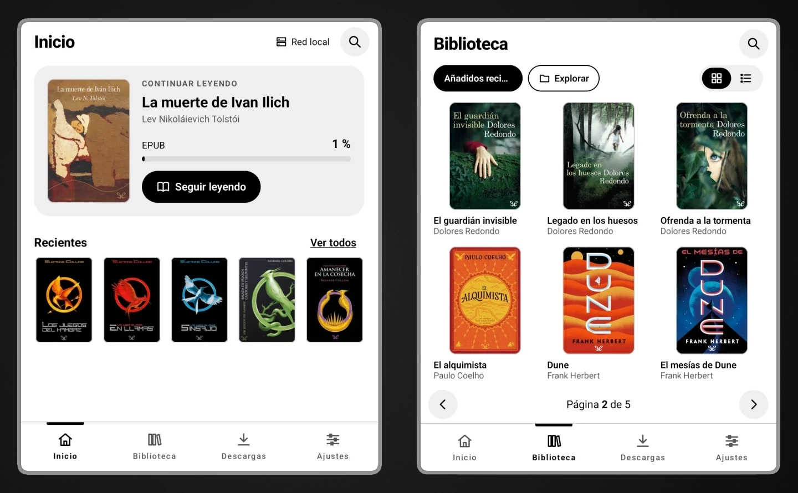
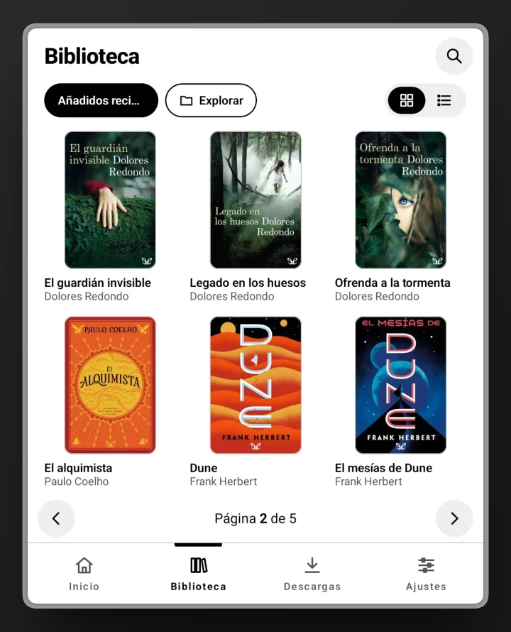
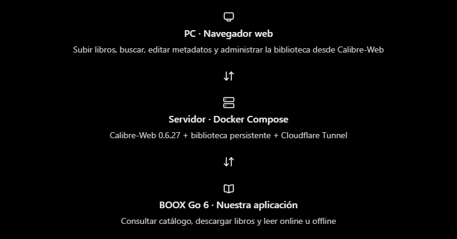

<div align="center">


# BibliotecaGO

**Tu biblioteca de Calibre-Web, en el BOOX Go 6.**

Biblioteca y lector personal para tinta electrónica: explora el catálogo de tu servidor,<br>
descarga EPUB y PDF y léelos dentro de la app, con o sin conexión.

Android 11+ · Kotlin · Jetpack Compose · OPDS · Readium

</div>

<p align="center">
  
  &nbsp;
  
</p>
<p align="center"><sub><b>Inicio</b> con el libro a medias y lo último añadido · <b>Biblioteca</b> en cuadrícula, paginada y sin scroll</sub></p>

---

## Índice

- [Qué es](#qué-es)
- [Funcionalidades](#funcionalidades)
- [Pensada para tinta electrónica](#pensada-para-tinta-electrónica)
- [Cómo encaja todo](#cómo-encaja-todo)
- [Requisitos del servidor](#requisitos-del-servidor)
- [Instalación](#instalación)
- [Desarrollo](#desarrollo)
- [Arquitectura](#arquitectura)
- [Seguridad y privacidad](#seguridad-y-privacidad)
- [Estado y roadmap](#estado-y-roadmap)
- [Créditos y licencias](#créditos-y-licencias)

---

## Qué es

BibliotecaGO es una aplicación Android nativa, de uso personal, que conecta el lector **BOOX Go 6** con un servidor **Calibre-Web** (o **Calibre-Web-Automated**) autoalojado. El catálogo vive en el servidor; el BOOX lo consulta por **OPDS**, descarga los libros que quieras y los abre en su propio lector EPUB y PDF.

La app es de **solo lectura** respecto al servidor: no sube ni modifica libros. Lo único que escribe es el estado «leído», para que coincida con el de la web.

---

## Funcionalidades

### Inicio
- **Continuar leyendo**: el último libro abierto, con su progreso y un botón para volver justo donde lo dejaste.
- **Recientes**: lo último que ha entrado en Calibre, con un aviso discreto de cuántos son nuevos desde la última visita.
- **Estado del servidor** en la cabecera: *Red local*, *Túnel*, *Conectando…* o *Sin conexión*.

### Biblioteca y búsqueda
- Catálogo en **cuadrícula de portadas o lista**, por páginas («Página 2 de 5») en lugar de scroll continuo.
- Ordenación por los listados de Calibre-Web (*Añadidos recientemente*, título, autor…) o por **último abierto**. El orden elegido se recuerda al volver a abrir la app.
- **Explorar** por autor, serie y etiquetas, y **búsqueda** por texto.
- Cada portada indica si el libro está **leído** (ojo) o **descargado** (círculo).

### Ficha del libro
- Portada, sinopsis, serie, idioma, formatos disponibles y estado local.
- Si lo estás leyendo, «Página 42 de 310 · 13 %» con una barra fina; si no, el número de páginas (en los descargados).
- Descargar, abrir, borrar del dispositivo y **marcar o desmarcar como leído**.

### Lectura
- **Lector EPUB** (Readium): tipografía, tamaño, interlineado, márgenes, tabla de contenidos, marcadores y búsqueda de texto.
- **Lector PDF** (PdfRenderer/PDFium): ajuste al ancho o a la página y zoom, con la página siguiente preparada en segundo plano.
- Posición y progreso guardados en el dispositivo; la barra inferior se oculta al leer.
- Ajustes de lectura por formato en **Ajustes → Lectura**.

### Sincronización y conexión
- **Leídos en los dos sentidos** con Calibre-Web: lo que marcas en la app se envía al momento (o en cuanto vuelve la red) y lo marcado en la web llega solo.
- **Libros nuevos sin recargar**. Calibre-Web no avisa de cambios, así que la app le pregunta con consultas pequeñas: cada 20 s con Inicio en pantalla y cada 5 min en el resto. Solo se redibuja si de verdad hay algo nuevo, y en segundo plano no se consulta nada.
- **Reconexión al instante**: al volver la red, la app reintenta lo pendiente y recarga lo que había fallado sin tener que reiniciarla.
- **URL local y túnel**: en casa usa la dirección de la red local y fuera, la del túnel HTTPS, cambiando sola entre ambas.
- **Modo sin conexión** para todo lo descargado.

### Descargas
- EPUB y PDF al almacenamiento privado de la app, con progreso, reintentos y gestión del espacio.

> **Fuera del alcance:** subir libros desde la app, abrir archivos locales del BOOX, editar metadatos, sincronizar el progreso entre dispositivos, anotaciones y resaltados, varios servidores o perfiles, DRM y cualquier tipo de telemetría.

---

## Pensada para tinta electrónica

Cada redibujado en E Ink se nota, así que la interfaz está hecha para moverse lo menos posible:

- **Blanco y negro, alto contraste**. Ningún estado depende del color.
- **Cero animaciones**: sin ripple, sin transiciones entre pantallas y sin `animate*`, `AnimatedVisibility`, `Crossfade` ni `Pager`. La tarea `checkNoAnimations` rompe la compilación si alguna se cuela.
- **Contenido paginado** en lugar de scroll continuo.
- **Controles grandes** y sin menús profundos.
- **Capa propia de componentes** (`core/eink`) sobre Compose Foundation, sin Material.
- **Redibujar solo lo que cambia**: las consultas periódicas no tocan la pantalla si no hay nada nuevo.
- **Arranque sobrio**: logo vectorial y «By Ronambulo», sin animación.

```
┌───────────┬────────────┬────────────┬──────────┐
│  Inicio   │ Biblioteca │ Descargas  │ Ajustes  │
└───────────┴────────────┴────────────┴──────────┘
```

> El emulador no reproduce el refresco E Ink: la validación final siempre se hace en el BOOX.

---

## Cómo encaja todo



| Pieza | Papel |
|---|---|
| **PC · navegador** | Subir libros, editar metadatos y administrar la biblioteca desde Calibre-Web. |
| **Servidor · Docker Compose** | Calibre-Web-Automated, la biblioteca persistente y Cloudflare Tunnel. Única fuente del catálogo y de los archivos. |
| **BOOX Go 6 · BibliotecaGO** | Consultar el catálogo, descargar libros y leer con o sin conexión. |

---

## Requisitos del servidor

- **Calibre-Web 0.6.27** o **Calibre-Web-Automated** en Docker Compose, con el volumen de la biblioteca montado **con escritura**.
- **OPDS** accesible en `/opds` con autenticación básica.
- Publicado en un hostname propio mediante **Cloudflare Tunnel** (HTTPS) para usarlo fuera de casa.
- **Dos usuarios**:
  - un administrador, para el navegador del PC;
  - un usuario de **solo lectura** para la app (sin admin, subida ni edición; con *Permitir descargas*).

  El usuario de la app tiene que poder iniciar sesión también en la web: el estado «leído» no se cambia por OPDS, así que la app lo marca a través de `/ajax/toggleread`.
- **Libros por página**: vale cualquier valor (60 por defecto). El OPDS pagina con `offset` y no admite `limit`, así que este ajuste fija el tamaño de cada tanda.
- Recomendado:
  - registro público desactivado y limitador de intentos de login;
  - una regla de Cloudflare para **no cachear** `/opds` ni las descargas;
  - copias de seguridad de la biblioteca y de `config/`.

> Las subidas grandes, mejor desde casa por la URL local: el plan gratuito de Cloudflare limita cada petición a 100 MB.

---

## Instalación

### 1. Conseguir el APK

Cada push lanza el workflow **APK** ([`.github/workflows/apk.yml`](.github/workflows/apk.yml)), que pasa las pruebas, el lint y la comprobación de animaciones y publica el APK como artefacto. Para descargarlo: **Actions** → última ejecución en verde → **Artifacts**. Llega en un `.zip` y se guarda 90 días.

| Artefacto | Qué es | Para qué |
|---|---|---|
| `BibliotecaGO-N` | Release firmado con la clave propia (`com.bibliotecago`) | Uso diario en el BOOX |
| `BibliotecaGO-debug-N` | Debug (`com.bibliotecago.debug`), con una clave que cambia en cada ejecución | Solo pruebas; no se actualiza encima |

`N` es el número de ejecución y también el `versionCode`, así que cada APK es más nuevo que el anterior.

### 2. Primera instalación en el BOOX Go 6

1. Descomprime el `.zip` y pasa `app-release.apk` al BOOX (USB, **BOOXDrop** o el navegador del BOOX).
2. Ábrelo con el gestor de archivos. Android pedirá permitir **instalar aplicaciones desconocidas** solo para ese gestor.
3. Abre **BibliotecaGO** y ve a **Ajustes → Servidor**.
4. Introduce la URL del túnel, la URL local (opcional), el usuario de lectura y su contraseña, y pulsa **Probar conexión**.
5. En las opciones de la app en BOOX (mantén pulsado el icono → **Optimizar**):
   - elige el refresco **HD** o **Equilibrado**;
   - activa el refresco completo cada pocas páginas para limpiar el ghosting.

### 3. Actualizar

Abre el APK release nuevo en el BOOX e **instala encima**, sin desinstalar. Se conservan el progreso, los marcadores, los leídos, las descargas y la configuración.

Si Android dice que la app «no se ha instalado», casi siempre es una de estas causas:

- **Debug encima de release (o al revés).** Son apps distintas que pueden convivir, pero no se actualizan entre sí.
- **Otra clave de firma.** Solo se arregla desinstalando, y entonces **se pierde** el progreso guardado. Por eso hay que guardar copia de la keystore.
- **Una versión anterior.** Android no instala un `versionCode` menor encima de uno mayor.

---

## Desarrollo

Necesitas Android Studio (o el Android SDK con `ANDROID_HOME`) y JDK 17 o superior.

```bash
./gradlew assembleDebug        # APK de depuración
./gradlew installDebug         # instalar en el BOOX conectado por USB
./gradlew check                # pruebas + regla anti-animaciones
./gradlew checkNoAnimations    # solo la regla E Ink
```

`checkNoAnimations` falla si aparece en `src/` alguna API que anime: `animate*`, `AnimatedVisibility`, `AnimatedContent`, `Crossfade`, ripple, transiciones o `Pager`.

Las pruebas del catálogo usan respuestas OPDS reales guardadas como fixtures en `catalog/src/test/resources/opds/`.

### Release firmado

El release pasa por **R8** (minificación y recorte de recursos). La clave de firma y sus contraseñas **nunca entran en el repositorio**. Gradle las lee de un `keystore.properties` externo:

- en la ruta de la variable de entorno `BIBLIOTECAGO_SIGNING`;
- si no está definida, en `~/.bibliotecago/keystore.properties`.

1. Crea la clave una sola vez. Android exige la misma clave para actualizar, así que dura unos 27 años:

   ```bash
   keytool -genkeypair -v -keystore ~/.bibliotecago/bibliotecago.jks -alias bibliotecago -keyalg RSA -keysize 4096 -validity 10000
   ```

2. Crea `~/.bibliotecago/keystore.properties`. `storeFile` puede ser relativo a este archivo:

   ```properties
   storeFile=bibliotecago.jks
   storePassword=…
   keyAlias=bibliotecago
   keyPassword=…
   ```

3. Compila con `./gradlew assembleRelease`. El APK queda en `app/build/outputs/apk/release/app-release.apk`. Sin `keystore.properties` sale `app-release-unsigned.apk`, que no se puede instalar.

4. **Guarda copia** del `.jks` y de las contraseñas fuera del ordenador. Si pierdes la clave, las versiones nuevas no se instalarán encima.

Para que GitHub Actions firme el release, crea estos secretos en **Settings → Secrets and variables → Actions**:

| Secreto | Valor |
|---|---|
| `KEYSTORE_BASE64` | El `.jks` en base64: `base64 -w0 bibliotecago.jks`. En Windows: `[Convert]::ToBase64String([IO.File]::ReadAllBytes("bibliotecago.jks"))` |
| `KEYSTORE_PASSWORD` | Contraseña del almacén |
| `KEY_ALIAS` | Alias de la clave (`bibliotecago`) |
| `KEY_PASSWORD` | Contraseña de la clave |

El workflow escribe la clave en una carpeta temporal del runner y la borra al terminar.

---

## Arquitectura

| Pieza | Decisión |
|---|---|
| Dispositivo | BOOX Go 6 · Android 11 → `minSdk 30`, `targetSdk 36` |
| Lenguaje | Kotlin, corrutinas y `Flow` |
| Interfaz | Jetpack Compose (Foundation, sin Material) + componentes E Ink propios |
| Red | OkHttp con autenticación básica + parser OPDS propio |
| Imágenes | Coil 3 (portadas redimensionadas, caché en memoria y disco) |
| Descargas | WorkManager (progreso y reintentos) |
| Base de datos | Room: descargas, progreso, marcadores y leídos pendientes |
| EPUB | Readium Kotlin Toolkit |
| PDF | `PdfRenderer` de Android (PDFium) |
| Credenciales | Cifradas con Android Keystore |
| Distribución | APK firmado, instalación manual |

```
app/            Pantallas, navegación, consultas periódicas y reconexión
core/eink/      Componentes E Ink (sin animaciones ni ripple)
core/model/     Modelo de dominio (Kotlin puro)
server/         Configuración, credenciales, URL local/túnel y estado de conexión
catalog/        Cliente OPDS, búsqueda, paginación, metadatos y portadas
downloads/      Transferencias, almacenamiento y reintentos
library/        Libros descargados, progreso, marcadores y leídos (Room)
reader-epub/    Lector EPUB (Readium)
reader-pdf/     Lector PDF (PdfRenderer)
settings/       Preferencias de lectura y de la app
```

---

## Seguridad y privacidad

- Validación TLS siempre activa. HTTP solo hacia direcciones de red privada.
- Credenciales cifradas con Android Keystore; nunca en logs ni dentro del APK.
- Sin analíticas, sin telemetría y sin servicios de terceros: la app solo habla con tu servidor.

---

## Estado y roadmap

Versión **0.1.0**, en desarrollo. Ya funcionan el catálogo, las descargas, los dos lectores, la sincronización de leídos y el uso sin conexión. Falta la validación final en el BOOX real y cerrar los criterios de aceptación de la v1.0.

| Fase | Objetivo |
|---|---|
| **0 · Validación técnica** | Android del BOOX, OPDS de Calibre-Web, túnel y motores de lectura |
| **1 · Prototipo visual** | Capa E Ink y pantallas navegables |
| **2 · Catálogo y descargas** | Cliente OPDS, portadas, búsqueda y descargas |
| **3 · Lectura** | Lectores EPUB y PDF, progreso, marcadores y búsqueda |
| **4 · Seguridad y uso remoto** | Túnel desde fuera, credenciales y cortes de red |
| **5 · Pruebas y distribución** | Catálogo completo, PDF pesados y APK firmado v1.0 |

Detalle con tareas y criterios de salida: [ROADMAP.md](ROADMAP.md). Requisitos completos: [biblioteca-boox-go6.md](biblioteca-boox-go6.md).

---

## Créditos y licencias

- [Readium Kotlin Toolkit](https://github.com/readium/kotlin-toolkit) — BSD-3-Clause
- [OkHttp](https://github.com/square/okhttp) y [Coil](https://github.com/coil-kt/coil) — Apache 2.0
- Jetpack (Compose, Room, WorkManager, Navigation) — Apache 2.0
- [Roboto](https://github.com/googlefonts/roboto) — Apache 2.0. Se usa en el texto de la pantalla de arranque, convertido a trazados vectoriales.
- Calibre-Web y Calibre-Web-Automated son proyectos independientes. BibliotecaGO solo se conecta a ellos por OPDS.

BibliotecaGO es un proyecto de uso exclusivamente personal. No se distribuye la aplicación.

<div align="center"><sub>By Ronambulo</sub></div>
